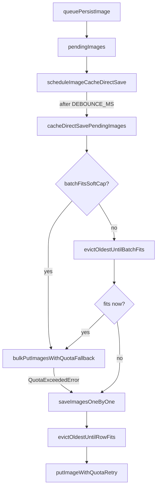

# Image cache scheduler — function tree & flow

Source: `src/utils/itemsCacheDb.js`  
Related: `src/utils/itemsIndexedDb.js`, `src/utils/itemCache.js`, `src/store/state.js`, `src/services/ReceiptService.js`

Soft caps: **2000 images** / **500 MB** (`MAX_DISK_IMAGE_ENTRIES` / `MAX_DISK_IMAGE_CHARS`).  
Debounce: **`DEBOUNCE_MS` = 1000**.

---

## Entry points

```
Callers (state.js)
  ensureItemImages / addItemImageCache / addItemCache
        │
        ▼
queuePersistImage(itemId, image)
        │  pendingImages.set(id, { id, image, size, cachedAt })
        ▼
scheduleImageCacheDirectSave()
        │  (debounce 1s; only one timer)
        ▼
cacheDirectSavePendingImages()
```

Separate path (does **not** go through the scheduler):

```
ReceiptService saveReceipt / saveDraft / updateDraft
        │
        ▼
state.updateImageCachedAtTime(itemIds)
        ├── updateCachedItemImageTime (RAM LRU)
        └── itemsCacheDb.updateImageCachedAtTime (disk cachedAt)
```

---

## Full tree

```
queuePersistImage(itemId, image)
├── normalizeId(itemId)
├── pendingImages.set(...)          // RAM staging queue
└── scheduleImageCacheDirectSave()
    ├── if imageCacheDirectSaveTimer → return   // already scheduled
    └── setTimeout(DEBOUNCE_MS)
        ├── imageCacheDirectSaveTimer = null
        └── cacheDirectSavePendingImages()
            ├── take batch from pendingImages; clear queue
            ├── idbGetAll('images')
            ├── summarizeDiskImages(rows)
            │     └── returns { byId, totalChars, count }
            │
            ├── [A] batchFitsSoftCap(usage, batch)?
            │     ├── projectUsageAfterBatch(usage, batch)
            │     │     └── simulate overwrite vs new id sizes/counts
            │     └── if fits → bulkPutImagesWithQuotaFallback(batch) → END
            │
            ├── [B] evictOldestUntilBatchFits(usage, batch)
            │     ├── projectUsageAfterBatch(usage, batch)
            │     ├── candidates = disk rows NOT in pendingIds, sorted by cachedAt ASC
            │     ├── while over soft cap && candidates:
            │     │     ├── candidates.shift()   // oldest
            │     │     ├── idbDelete('images', oldest.id)
            │     │     └── update usage / projected chars+count
            │     └── batchFitsSoftCap(usage, batch)?
            │           └── if fits → bulkPutImagesWithQuotaFallback(batch) → END
            │
            └── [C] saveImagesOneByOne(usage, batch)
                  └── for each row:
                        ├── evictOldestUntilRowFits(usage, row)
                        │     ├── project this one row onto usage
                        │     ├── candidates = other ids, oldest first
                        │     ├── while over soft cap: idbDelete oldest
                        │     └── return whether row now fits
                        ├── if !fits → warn + skip
                        ├── putImageWithQuotaRetry(row)
                        │     ├── idbPut('images', row)
                        │     └── on QuotaExceededError:
                        │           ├── evictImagesOnDisk(maxEntries, maxChars)
                        │           │     └── delete oldest until under soft cap
                        │           ├── idbPut retry once
                        │           └── still quota → warn + return false
                        └── if saved → applyRowToUsage(usage, row)
                              else refresh usage via summarizeDiskImages(idbGetAll)
```

### `bulkPutImagesWithQuotaFallback(batch)` subtree

```
bulkPutImagesWithQuotaFallback(batch)
├── try idbBulkPut('images', batch) → success → done
└── catch QuotaExceededError
      ├── summarizeDiskImages(idbGetAll('images'))
      └── saveImagesOneByOne(...)     // same one-by-one path as [C]
```

---

## Flow by scenario

### 1. Normal — batch fits under soft cap

1. `queuePersistImage` (possibly many times within 1s)  
2. Timer fires → `cacheDirectSavePendingImages`  
3. `batchFitsSoftCap` true  
4. `idbBulkPut` once  

### 2. Batch too big — eviction makes room

1. Soft cap would be exceeded after applying batch  
2. `evictOldestUntilBatchFits` deletes oldest **non-batch** images  
3. If batch now fits → `idbBulkPut`  

### 3. Still can’t fit whole batch

1. `saveImagesOneByOne`  
2. Per image: evict until that row fits → `idbPut`  
3. Skip image if still no room  

### 4. Browser `QuotaExceededError` (rare)

- On **bulk**: fall back to one-by-one  
- On **single put**: `evictImagesOnDisk` → one retry → skip if still failing  

### 5. Receipt / draft saved

1. API succeeds  
2. `state.updateImageCachedAtTime(itemIds)`  
3. RAM: `updateCachedItemImageTime` per id  
4. Disk: `itemsCacheDb.updateImageCachedAtTime` sets `cachedAt = Date.now()`  
5. Does **not** schedule a full image save  

---

## Helper cheat sheet

| Function | Role |
|----------|------|
| `queuePersistImage` | Stage image in `pendingImages`, start debounce |
| `scheduleImageCacheDirectSave` | One timer; coalesces bursts |
| `cacheDirectSavePendingImages` | Drain queue; choose bulk / evict+bulk / one-by-one |
| `summarizeDiskImages` | Current disk map: sizes + count |
| `projectUsageAfterBatch` | What usage would be after applying the batch |
| `batchFitsSoftCap` | Projected usage ≤ 500MB and ≤ 2000 |
| `evictOldestUntilBatchFits` | Free space for the whole batch |
| `evictOldestUntilRowFits` | Free space for one image |
| `bulkPutImagesWithQuotaFallback` | Prefer bulk; quota → one-by-one |
| `saveImagesOneByOne` | Fit / put / skip per image |
| `putImageWithQuotaRetry` | Single put + one quota retry |
| `applyRowToUsage` | Update in-memory usage after a successful put |
| `evictImagesOnDisk` | Trim disk to soft cap (oldest `cachedAt` first) |
| `state.updateImageCachedAtTime` | RAM + disk freshness for receipt/draft items |
| `itemsCacheDb.updateImageCachedAtTime` | Disk/pending `cachedAt` only |

---

## Mermaid overview


